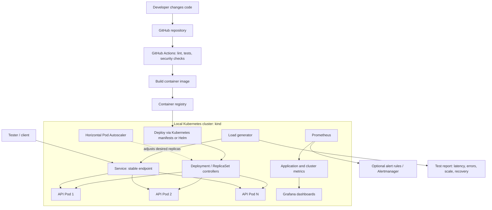
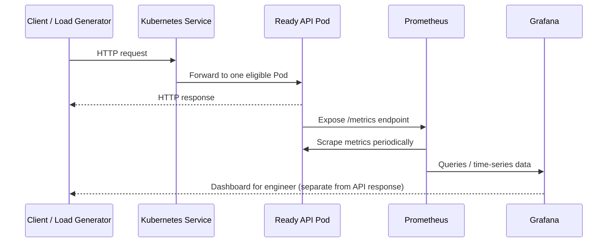
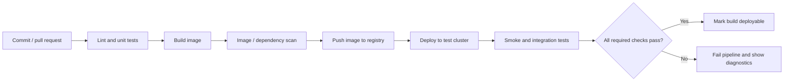
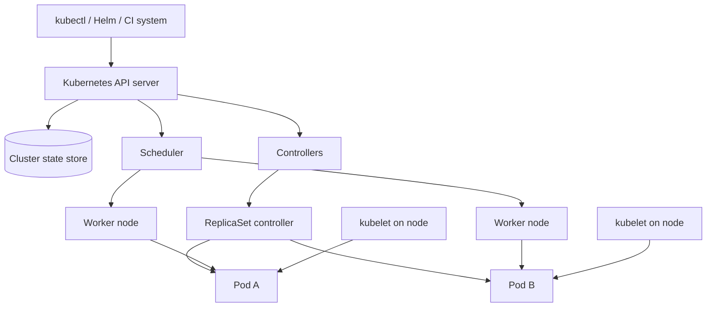
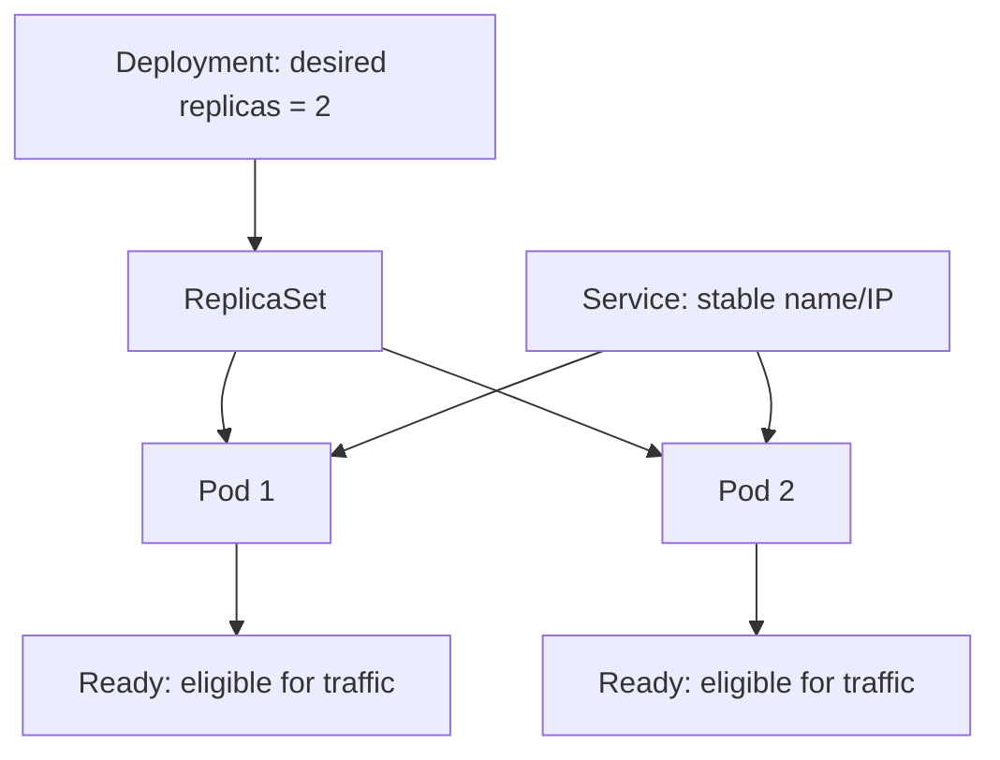
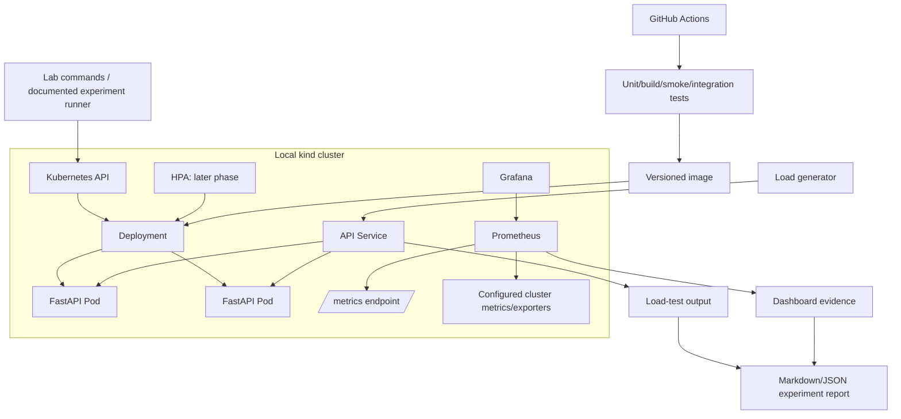

# DevOps + Kubernetes + Observability: Study and Build Guide

**Purpose:** Learn DevOps fundamentals deeply while building a credible, demonstrable infrastructure project in parallel. This is a research and implementation plan—not the implementation of the project itself.

**Research checked:** 29 October 2026. Official documentation links are included throughout. Tool versions and cloud prices change; use the linked official docs when executing a lab.

---

## 0. Executive summary

You have already built software products that go beyond small demos: an AI code editor/CLI, an inference-engine project, and AI/ML workflow systems. The next project should expand your engineering range into infrastructure rather than simply add another AI interface.

The recommended direction is:

> **Learn Docker, Kubernetes, observability, CI/CD, and infrastructure automation by building a Kubernetes Reliability Lab: a containerized API that can be deployed repeatably, monitored, scaled under load, and tested for recovery when a replica fails. After the infrastructure workflow is reliable, optionally replace the simple API with a real AI inference server.**

This is a strong learning and portfolio project, but it is not automatically a novel commercial product. Existing systems already cover many parts. Do not claim novelty until you have researched the precise problem and compared implementation behavior.

### The two tracks

1. **Study track:** Understand concepts, architecture, commands, trade-offs, and failure modes.
2. **Build track:** Implement a small, testable lab for each concept, gradually composing the labs into one end-to-end system.

Do both in parallel. Do not study every DevOps topic for months before building anything, and do not jump straight to a large platform before understanding the primitives.

### What the finished portfolio project should prove

- The service is containerized and reproducibly built.
- Kubernetes deploys and maintains the desired number of replicas.
- Traffic reaches only ready Pods through a stable Service endpoint.
- CPU/memory requests and limits are configured intentionally.
- Scaling behavior is tested under controlled load, not asserted from configuration alone.
- Prometheus collects metrics and Grafana explains observed behavior.
- A deliberate Pod failure is introduced and service recovery is measured.
- GitHub Actions tests and builds the application image, then validates deployment behavior in an automated environment.
- Documentation records the architecture, commands, expected output, failure scenarios, and measured results.
- A later optional phase runs a real model-serving backend and compares the workload behavior.

---

# Part I — Understand the goal before learning tools

## 1. What is DevOps?

DevOps is a way of building, deploying, operating, observing, and improving software with shared responsibility and automation between development and operations. It is not one tool or one job title.

A typical software journey is:

1. A developer changes code.
2. Automated checks test the change.
3. The application is packaged into an immutable container image.
4. The image is stored in a registry.
5. A deployment system releases the image into an environment.
6. The application receives real requests.
7. Metrics, logs, and traces show whether it works.
8. Alerts notify the team when behavior violates expectations.
9. Engineers troubleshoot, roll back, or fix the issue.
10. The team improves the process based on what happened.

DevOps engineering focuses on making that sequence repeatable, safe, observable, secure, and recoverable.

## 2. Related roles and where this project fits

| Role | Main responsibility | Skills this guide develops |
|---|---|---|
| DevOps Engineer | Automates build, test, deployment, infrastructure and operations workflows | Docker, CI/CD, Kubernetes, Terraform, monitoring |
| Cloud Engineer | Designs and operates cloud resources, networking, identity and reliability | Cloud networking, IAM, GKE, Terraform, cost/security controls |
| Platform Engineer | Builds reusable internal platforms and workflows for developers | Kubernetes APIs, Helm, automation, self-service interfaces |
| Site Reliability Engineer (SRE) | Applies engineering to availability, performance, incident response and toil reduction | SLOs, alerts, load testing, recovery, capacity analysis |
| MLOps / AI Infrastructure Engineer | Operates model training/serving infrastructure and model delivery workflows | Kubernetes, GPU/CPU workloads, model serving, inference metrics, automation |

The proposed learning project overlaps with DevOps, platform engineering, and SRE. The optional model-serving phase adds MLOps/AI infrastructure relevance.

## 3. What problem are we actually solving?

A working API is not automatically a reliable service. It can run successfully on a laptop and still fail when:

- traffic rises beyond the capacity of one process;
- the process becomes unhealthy;
- a container exits;
- a Pod is terminated during an update;
- a new image is broken;
- the application has insufficient CPU or memory;
- the service is running but not ready to receive traffic;
- the monitoring system cannot see the failure;
- the deployment process cannot safely roll back.

The project makes these behaviors observable and testable.

### Project problem statement

> Engineers need a repeatable way to validate that a containerized service can be deployed, observed, scaled under increasing load, and recover from a defined failure. The Kubernetes Reliability Lab will provide a local-first environment, automated deployment pipeline, operational dashboards, controlled load tests, failure-recovery experiments, and reproducible evidence of the results.

### What this project is—and is not

**It is:** a serious DevOps learning and portfolio project that demonstrates infrastructure understanding through measurable experiments.

**It is not initially:** a new Kubernetes distribution, replacement for Prometheus/Grafana, a custom autoscaler, a production-grade hosting platform, or a novel AI operations product.

**Optional extension:** deploy a real AI model server after the basic infrastructure behavior works. The AI model is a workload; Kubernetes and the observability/reliability system remain the main engineering focus.

---

# Part II — The complete architecture

## 4. Big-picture architecture

The first version uses a simple API. The project then extends to a model server without changing the core DevOps workflow.



**Important:** the diagram is conceptual. Some metrics need exporters or application instrumentation. The HPA usually uses the Kubernetes resource metrics API for CPU/memory; Prometheus does not automatically become the HPA's metric source just because it is installed. Custom-metric autoscaling requires an additional integration/adapter or another supported mechanism.

## 5. The request path



Prometheus usually scrapes metrics from targets over HTTP and stores numeric time series. Grafana queries data sources such as Prometheus and visualizes the measurements. The dashboard is for the operator; it does not itself fix the service or scale it.

## 6. The deployment pipeline



The initial CI pipeline need not deploy to a public cloud. It can use a temporary local Kubernetes environment in CI or perform image-level checks first, then add cluster integration tests as the project matures.

---

# Part III — Concepts to learn, in order

## 7. Linux and basic networking

Docker and Kubernetes do not remove the need to understand the operating system. When something fails, you often diagnose a Linux process, a socket, file permissions, DNS resolution, or resource exhaustion.

Learn:

- processes and signals;
- environment variables and exit codes;
- file permissions and users/groups;
- ports, TCP, HTTP, DNS, localhost, and binding to `0.0.0.0` versus `127.0.0.1`;
- basic commands: `ps`, `top`/`htop`, `free`, `df`, `du`, `ss`, `curl`, `grep`, `tail`, `journalctl`;
- logs, stdout/stderr, and process exit codes.

**Lab:** Run a local API, inspect its process, call it using `curl`, deliberately use the wrong port, and inspect the error. Run the service bound to `127.0.0.1`, then to `0.0.0.0`; understand why the binding affects connectivity from outside the process/container.

## 8. Docker: package the application

### 8.1 What Docker gives you

A **container image** is a packaged filesystem and metadata used to create containers. It includes the application and its runtime dependencies. A **container** is a running instance of an image, isolated using operating-system mechanisms. A container is not a complete virtual machine: containers share the host kernel.

The goal is that the application behaves predictably across your laptop, CI, and Kubernetes because the runtime artifact is versioned.

### 8.2 Concepts

| Concept | Plain-language explanation | Why you need it |
|---|---|---|
| Dockerfile | Instructions for building an image | Repeatable packaging |
| Image | Versioned application package | Same artifact across environments |
| Container | Running instance of an image | Local execution and debugging |
| Registry | Storage for images | CI and clusters pull the same image |
| Port mapping | Connects a host port to a container port | Reach a local service |
| Volume | Persistent or mounted data | Preserve or share data beyond container lifetime |
| Network | Connectivity among containers | Multi-service applications |
| Layer/cache | Reuses unchanged build steps | Faster builds |
| Multi-stage build | Separates build dependencies from runtime image | Smaller and safer runtime images |
| Non-root user | Runs the application without root privileges | Limits damage if compromised |

### 8.3 What to learn and practice

- Build, run, inspect, stop and remove a container.
- Map a port and verify the API with `curl`.
- Read application logs and inspect the exit code.
- Pass configuration using environment variables; do not bake secrets into images.
- Add a `.dockerignore` file.
- Use a non-root runtime user.
- Learn caching and multi-stage builds after the basic image works.
- Learn image tagging and why `latest` alone is not sufficient for reproducible releases.
- Understand that data inside an ephemeral container filesystem may disappear when the container is replaced.

### 8.4 Core commands to know

```bash
docker build -t reliability-api:dev .
docker run --rm -p 8000:8000 reliability-api:dev
docker ps
docker logs <container-id>
docker inspect <container-id>
docker stop <container-id>
docker image ls
```

These are learning commands; the actual service's port and image name will depend on its implementation.

**Definition of done:** you can build the image from a clean checkout, run it, make a request, inspect logs, explain port mapping, and reproduce a failure without relying on a locally installed application runtime.

## 9. Kubernetes: orchestrate containers

### 9.1 What Kubernetes does

Kubernetes is a platform for managing containerized workloads. You declare the desired state—for example, “keep two replicas running”—and its controllers work to reconcile actual state with that desired state. It provides scheduling, workload management, service discovery, configuration, resource management, and extension points.

### 9.2 Cluster architecture



A simplified explanation:

- **Control plane:** accepts API requests, stores cluster state, chooses where Pods should run, and runs controllers that reconcile state.
- **Node:** machine that runs Pods. It may be a VM or a physical machine.
- **Pod:** smallest deployable Kubernetes unit; it commonly contains one application container, although a Pod can contain multiple closely related containers.
- **Controller:** continuously compares desired state with actual state and takes action to reduce the difference.
- **`kubectl`:** command-line client for the Kubernetes API.

In a managed service such as GKE, the cloud provider manages much of the control-plane lifecycle. The exact node-management responsibilities depend on the operating mode.

### 9.3 Essential Kubernetes objects

| Object | What it means | Example in this project |
|---|---|---|
| Pod | Running application instance | One API replica |
| Deployment | Declares a desired set of interchangeable Pods and manages rollout/rollback via ReplicaSets | Maintain two API replicas |
| ReplicaSet | Keeps the requested number of matching Pods | Replaces a deleted Pod under a Deployment |
| Service | Stable network endpoint for a set of Pods | Load-balance requests to ready API Pods |
| ConfigMap | Non-secret configuration | Log level or app mode |
| Secret | Sensitive configuration object | Secret values; must still be protected with appropriate RBAC/encryption and not casually exposed |
| Namespace | Logical grouping in a cluster | Isolate project resources from other lab resources |
| Ingress / Gateway | HTTP(S) entry and routing configuration, depending on the chosen implementation | Optional external access later |
| Job | Runs work to completion | One-shot experiment or test job |
| CronJob | Runs a Job on a schedule | Optional periodic smoke test |
| PersistentVolume / PersistentVolumeClaim | Storage abstraction and request | Only if the project needs persistent files or a database |
| ServiceAccount / RBAC | Workload identity and permissions within Kubernetes | Give automation only the permissions it requires |
| HorizontalPodAutoscaler (HPA) | Adjusts a scalable workload's desired replica count from observed metrics | Add replicas as CPU load rises |

### 9.4 Declarative configuration

Kubernetes manifests are usually YAML documents describing the desired state. You apply the configuration to the API, and controllers act on it. This differs from a shell script that imperatively performs every step. You still need to understand what the controllers do and inspect the actual state after applying a manifest.

### 9.5 Deployment, Service, and Pods: how they fit together



A Service generally selects Pods using labels. The Pods can be replaced and receive different IP addresses; clients use the Service endpoint instead of remembering each Pod IP.

### 9.6 Readiness, liveness, and startup probes

These concepts are different and should not be treated as synonyms.

- **Readiness probe:** Can this instance receive traffic right now? If it fails, the Pod is marked unready and normally removed from the Service's eligible endpoints.
- **Liveness probe:** Is the process stuck or unhealthy in a way that restarting it might repair? Repeated failures can cause the container to restart.
- **Startup probe:** Does this application need a longer initial startup window? It protects slow-starting applications from being restarted too soon while they initialize.

A wrong liveness probe can make an incident worse by continuously restarting a slow service. A readiness probe should not claim that a service is ready merely because the process exists; it should reflect the ability to serve the kind of traffic it receives.

### 9.7 Resource requests and limits

- **CPU/memory request:** What resource amount the scheduler uses when placing a Pod (and, depending on the resource, the amount used for utilization calculations).
- **CPU/memory limit:** The upper resource boundary applied to a container by the runtime/kernel mechanisms.
- Too-low CPU can cause throttling and latency.
- Too-low memory can cause out-of-memory termination.
- Excessive requests reduce cluster packing efficiency and can cause Pods to remain unschedulable.
- Setting values is not enough; measure under workload and understand the results.

### 9.8 Scaling: do not confuse the mechanisms

**Horizontal Pod Autoscaler (HPA):** changes how many Pods run for a workload, such as increasing a Deployment from two replicas to four.

**Vertical Pod Autoscaler (VPA):** adjusts resource requests for Pods where configured and supported; it is not simply another name for HPA.

**Cluster/node autoscaling:** adds or removes node capacity when the cluster needs compute resources, according to the cluster provider and configuration.

These mechanisms act at different levels. HPA may ask for more Pods, but if there is no room to schedule them, node capacity or placement constraints can become the next bottleneck.

For CPU-based HPA, resource requests matter because utilization is calculated relative to requests. HPA is a feedback control loop that periodically observes metrics and adjusts desired replicas; it is not instantaneous and it needs sufficient workload and metrics to react.

### 9.9 Networking basics

Learn the path in this order:

1. Container listens on a port.
2. Pod has a network identity and IP.
3. Service selects eligible Pods and provides a stable endpoint.
4. Optional Ingress/Gateway or `LoadBalancer` Service exposes access beyond the cluster, depending on the environment.
5. Network policies and cloud firewalls can restrict communication.

Do not expose the sample service publicly until you understand access control and cloud load-balancer costs.

### 9.10 Essential `kubectl` commands

```bash
kubectl get nodes
kubectl get namespaces
kubectl get pods -A
kubectl get deploy,rs,svc
kubectl describe pod <pod-name>
kubectl logs <pod-name>
kubectl logs <pod-name> --previous
kubectl get events --sort-by=.metadata.creationTimestamp
kubectl describe deployment <deployment-name>
kubectl rollout status deployment/<deployment-name>
kubectl rollout history deployment/<deployment-name>
kubectl rollout undo deployment/<deployment-name>
kubectl top pods
kubectl top nodes
```

`kubectl top` requires a working resource metrics source. If it fails, don't assume the application is broken; inspect the cluster's metrics setup.

**Definition of done:** you can deploy a Deployment and Service from YAML, explain each relevant field, describe how a Pod is replaced, reach the application through the Service, watch a rollout, and diagnose a deliberately broken manifest.

## 10. Run Kubernetes locally with `kind`

`kind` means Kubernetes IN Docker. It creates a local Kubernetes cluster using Docker containers as its nodes. It is useful for learning, integration tests, and reproducible cluster experiments. It does not reproduce every feature or operational condition of a cloud environment.

Suggested progression:

1. Install Docker and verify that the engine works.
2. Install `kubectl` and `kind`.
3. Create a single-node local cluster.
4. Verify the node using `kubectl get nodes`.
5. Deploy the containerized API.
6. Test Service access, readiness, a failed Pod, and a rolling update.
7. Only then consider a multi-node local cluster for scheduling experiments.

Typical cluster lifecycle commands:

```bash
kind create cluster --name reliability-lab
kubectl cluster-info
kubectl get nodes
kind delete cluster --name reliability-lab
```

For local image development, you can either load a locally built image into kind or publish it to a registry that the cluster can access. Be deliberate about image tags and image pull behavior.

Official quick start: https://kind.sigs.k8s.io/docs/user/quick-start/

## 11. Helm: package Kubernetes applications

Once raw manifests make sense, learn Helm. Helm is a package manager for Kubernetes. A **chart** packages related Kubernetes resource templates; a **values file** supplies environment-specific configuration; a **release** is an installed instance of a chart.

Why use it:

- avoids copying a slightly different set of YAML files for every environment;
- centralizes configurable values such as replicas and resource limits;
- supports versioned installs, upgrades, and rollbacks;
- makes the project easier for another engineer to install.

Do not begin with Helm before understanding the underlying manifests. First deploy the application with YAML, then package the same resources into a chart.

Example commands to learn:

```bash
helm lint ./charts/reliability-api
helm template reliability-api ./charts/reliability-api
helm install reliability-api ./charts/reliability-api
helm upgrade reliability-api ./charts/reliability-api
helm history reliability-api
helm rollback reliability-api <revision>
```

These are illustrative; paths and release names will follow the eventual repository.

## 12. Observability: metrics, logs, traces, Prometheus and Grafana

### 12.1 Monitoring versus observability

Monitoring asks, “Is the system behaving within the conditions we care about?” Observability is the broader ability to infer internal system behavior from its outputs—commonly metrics, logs, and traces.

- **Metrics:** numeric measurements over time, such as request count, latency histogram, CPU usage, memory, and error rate.
- **Logs:** discrete events and messages, such as an exception or failed dependency call.
- **Traces:** a request's path through components, including timing of individual operations.
- **Profiles:** samples showing where CPU or memory is being spent; advanced/optional for the first project.

### 12.2 Prometheus

Prometheus is an open-source monitoring and alerting toolkit. It commonly scrapes instrumented applications and exporters over HTTP, stores time-series samples, and provides PromQL for queries and alert rules.

Learn:

- target, scrape, labels and time series;
- counters, gauges, histograms, and summaries conceptually;
- PromQL basics;
- application instrumentation and exporters;
- alert rules and how to avoid noisy alerts.

Example metrics for the project:

- request count/rate;
- request duration histogram;
- error count/rate;
- in-flight requests;
- process CPU/memory if exposed;
- container/Pod CPU and memory from the relevant cluster monitoring path;
- desired versus available replicas;
- Pod restarts and failed scheduling/events where the exporter/integration provides them.

Do not assume every metric exists automatically. Application metrics require instrumentation or an exporter; Kubernetes and node metrics usually require the appropriate monitoring components and permissions.

### 12.3 Grafana

Grafana visualizes data from Prometheus and other supported data sources. A useful dashboard should answer operational questions rather than merely look attractive.

Dashboard panels for this project:

1. Request rate (requests/second).
2. Error rate (percentage and count).
3. p50, p95, and p99 latency where the request volume and histogram design support meaningful estimates.
4. CPU and memory per replica.
5. Desired, ready and available replicas.
6. Pod restart count and current rollout state.
7. Load-generator concurrency / offered request rate.
8. A vertical marker or annotations for the start of a load or failure experiment, if supported by the setup.

### 12.4 SLI, SLO and SLA

- **SLI (Service Level Indicator):** measured signal, such as the percentage of requests returning successfully or the p95 response latency.
- **SLO (Service Level Objective):** target for an SLI, such as “at least 99% of requests succeed during this test window.”
- **SLA (Service Level Agreement):** an agreement, often contractual, that may include consequences if the promised level is missed.

For a portfolio experiment, define test SLOs clearly. Do not label your own test target a production SLA.

### 12.5 HPA metrics versus Prometheus metrics

This is a frequent source of confusion:

- Prometheus dashboards do not automatically control HPA.
- The standard CPU/memory HPA path uses the Kubernetes resource metrics API.
- Scaling on application-specific Prometheus metrics requires an appropriate custom/external metrics adapter or another integration such as a supported KEDA scaler.
- Install and configure only the complexity you are ready to test; start with CPU-based HPA, then add custom metrics if needed.

**Definition of done:** you can trigger a known load change, find the corresponding metric change, explain the dashboard, and distinguish measured facts from guesses about the root cause.

## 13. Load testing and controlled failure testing

### 13.1 Load testing

Load testing helps answer whether the service behaves acceptably under a defined traffic pattern. It is not enough to send requests and report a single average.

Define the workload:

- concurrency or arrival rate;
- duration and warm-up interval;
- request mix and payload sizes;
- success/error expectations;
- metrics to record;
- repeatability requirements.

Record at least latency percentiles, request throughput, error rate, and the load profile. Average latency can hide a poor tail, so p95/p99 can be valuable when sampled appropriately. With very few requests, percentiles can be unstable; document sample size.

Use a simple load generator first. Consider a dedicated tool such as k6 or Locust after the basic service is instrumented. For LLM endpoints later, a specialized tool such as NVIDIA AIPerf may be more appropriate than a generic HTTP benchmark, depending on the serving backend and metrics needed.

### 13.2 Failure testing

Failure testing asks whether the system behaves as expected when a defined fault occurs. Begin with safe, bounded experiments:

1. delete one of two API Pods;
2. verify the Deployment creates a replacement;
3. verify the Service still routes to ready Pods;
4. measure failed requests and recovery time;
5. deploy an intentionally broken image in a test namespace and confirm that rollout checks fail;
6. only later experiment with CPU pressure, memory pressure, network delay, or a chaos framework.

Never run disruptive experiments against a production or shared cluster without explicit authorization and isolation.

### 13.3 How to measure recovery

Define recovery before starting the experiment. For example:

- **Fault time:** time the Pod deletion or fault injection.
- **Impact window:** period in which requests fail or violate a latency target.
- **Recovery time:** time until measured service behavior returns to the agreed success criteria.
- **Result:** failed request percentage, total impact duration, whether replicas recovered, and whether the service returned to its SLO.

The thresholds should be measured, not invented after seeing the result.

## 14. CI/CD with GitHub Actions

CI/CD commonly means Continuous Integration and Continuous Delivery/Deployment. For this project, build a clear pipeline rather than adding many tools.

A practical first pipeline:

1. Trigger on pull requests and pushes.
2. Install dependencies in a clean environment.
3. Run formatting/lint checks and unit tests.
4. Build the Docker image.
5. Run a container smoke test.
6. Scan the image and dependencies with a selected security tool.
7. For the integration stage, deploy to a temporary test cluster or a controlled test environment.
8. Run health and integration checks.
9. Publish image artifacts with immutable/versioned tags after appropriate checks.
10. Keep secrets out of source code and give the workflow only the permissions it needs.

CI should fail clearly when a required check fails. Avoid automatically deploying every unreviewed change to a public environment in the initial project.

**Definition of done:** a pull request cannot pass if its automated tests or image build fail, and the workflow's result can be understood from the log without guessing.

## 15. Terraform and Infrastructure as Code

Terraform is an infrastructure-as-code tool. You define resources in configuration, inspect the proposed plan, and apply the changes through providers' APIs. It is useful for reproducibly creating cloud infrastructure such as networks, service identities, cluster resources, and related services.

Understand the boundary:

- **Terraform:** creates and manages infrastructure resources (for example, a VPC or a GKE cluster).
- **Kubernetes YAML / Helm:** describes and packages applications running within a Kubernetes cluster.
- **GitHub Actions:** automates steps that validate and deliver changes.

These tools can integrate, but they solve different layers of the workflow. Do not force Terraform into the first local-only iteration. Learn it after the local Kubernetes application is repeatable, then use it to provision optional cloud infrastructure.

Important Terraform concepts: providers, resources, variables, outputs, modules, state, plan/apply/destroy, secrets, remote state and locking (where supported by the chosen backend), and review of destructive plans. Protect state because it can contain sensitive information. Never commit credentials or sensitive state into a public repository.

---

# Part IV — GKE and where the infrastructure runs

## 16. What is GKE?

Google Kubernetes Engine (GKE) is Google's managed implementation of Kubernetes running on Google Cloud infrastructure. You still deploy standard Kubernetes workloads, but Google manages parts of the cluster lifecycle.

A cluster has:

- a **control plane**, including the Kubernetes API server, scheduler and controllers;
- **worker nodes** that provide compute for Pods;
- surrounding Google Cloud resources, such as networking and identity integrations.

### GKE Autopilot versus Standard

- **Autopilot:** Google manages more of the infrastructure configuration, worker-node operations, scaling, and security defaults. You concentrate more on the Pod/workload requests and application.
- **Standard:** you have more direct control over node pools and cluster infrastructure and take on more operational responsibilities.

For learning the Kubernetes primitives, use `kind` first. For the cloud extension, the choice depends on the skill you want to demonstrate. Autopilot can be convenient for running workloads with less cluster administration; Standard is useful when you specifically need to learn node-pool and cluster operations.

### What will you pay for?

Cloud costs can include cluster management charges, compute, disks, load balancers, network egress, logging/monitoring, and any GPU resources. Pricing varies by region, mode, configuration, and current provider terms. A free-tier or credit program is not a guarantee that every associated resource is free.

Before using GKE:

- read current official pricing;
- set billing budgets/alerts where available;
- avoid GPU nodes for the first version;
- avoid public load balancers unless needed;
- keep a written resource checklist;
- destroy experimental resources when done and verify deletion;
- check that disks, IPs, registries and other separately billed resources were also cleaned up.

The local-first path deliberately avoids creating a cloud bill during fundamental learning.

---

# Part V — The proposed project in practical terms

## 17. Working project name and scope

**Working name:** Kubernetes Reliability Lab (name is provisional; do not treat it as a brand or claim of uniqueness).

**One-line description:** A local-first, reproducible environment for deploying an API on Kubernetes, observing it under load, testing scaling, and measuring recovery from defined failures.

### Version 1: what we will build

- Small FastAPI application with `/health`, `/ready`, and a simple workload endpoint.
- Docker image and a reproducible build.
- Kubernetes Deployment and Service.
- Probes, requests/limits, configuration, and safe defaults.
- Local `kind` cluster.
- Basic load-generator script/tool.
- Prometheus metrics and Grafana dashboard.
- CPU-based HPA after the base workload is observable.
- Experiment scripts or documented manual procedure for increasing load and deleting a replica.
- CI pipeline for tests and image build.
- Report template for measured throughput, latency, errors, scaling behavior, and recovery.
- Clear README, architecture diagram, troubleshooting guide and demo instructions.

### Out of scope for version 1

- Building a new container runtime or Kubernetes controller.
- Replacing Prometheus, Grafana, Helm, Terraform, or a cloud provider.
- Building a new LLM or training model weights.
- Automatically changing production resources without approval.
- Large multi-cluster management.
- Cost optimization claims without reliable measurements.
- Public cloud deployment before local workflows work.

### Later extension: real AI inference

Once the simple API path works, add a model-serving backend that can be hosted in the test cluster. Choose the backend according to available CPU/GPU resources and the purpose of the experiment. The inference backend should be an adapter, not a reason to rewrite the entire platform.

With a model server, add AI-serving measurements where supported:

- request throughput;
- latency and tail latency;
- time to first token (for streaming generation endpoints);
- token throughput;
- queued/waiting requests;
- model-server errors;
- CPU/GPU/memory use, if accessible;
- output-quality evaluation on a fixed test set, if comparing model versions.

Do not try to report GPU or provider-internal metrics that the environment does not expose. An external API endpoint gives client-side behavior, not control over the provider's replicas or infrastructure.

## 18. Project architecture: first version



## 19. Suggested repository layout (target, not files created yet)

```text
kubernetes-reliability-lab/
├── app/
│   ├── main.py
│   ├── metrics.py
│   └── tests/
├── deploy/
│   ├── kubernetes/       # initial raw manifests
│   ├── helm/             # chart added after raw YAML is understood
│   └── monitoring/       # Prometheus/Grafana configuration as needed
├── experiments/
│   ├── load/             # load profiles and runner configuration
│   ├── failure/          # bounded failure experiment instructions
│   └── reports/          # example reports, no secrets or huge raw data
├── scripts/
├── .github/workflows/
├── docs/
│   ├── architecture.md
│   ├── runbook.md
│   ├── troubleshooting.md
│   └── experiments.md
├── Dockerfile
├── .dockerignore
├── Makefile              # optional convenience commands
├── pyproject.toml        # if using a Python package/tooling setup
└── README.md
```

Keep the initial project as simple as possible. Introduce directories when their contents exist instead of creating empty scaffolding for every future idea.

---

# Part VI — Learning and build roadmap

## 20. Milestones and deliverables

The sequence is intentionally dependency-driven. Each milestone ends with an observable result and a short piece of documentation. Time estimates depend on your current familiarity and available study time; focus on the exit criteria rather than rushing by date.

### Milestone 0 — Baseline environment

**Study:** terminal basics, Git, HTTP, ports, Docker installation and basic container lifecycle.

**Build lab:** run a small API natively and in Docker; make the same request against both.

**Evidence:** one README section containing setup commands, API example, and container logs.

**Exit criteria:** can build and run the image on a clean checkout without depending on Python packages installed globally on the host.

### Milestone 1 — Container reliability

**Study:** image layers, build context, volumes, networks, health endpoints, signal handling, non-root execution, resource constraints.

**Build lab:** add health endpoints, configure environment variables, inspect logs, and rebuild after a controlled code change.

**Evidence:** image size and build behavior documented; no secret baked into the image.

**Exit criteria:** understand why containers exit and can inspect the cause.

### Milestone 2 — Kubernetes fundamentals

**Study:** cluster, node, Pod, Deployment, ReplicaSet, Service, labels/selectors, namespaces, YAML, declarative state.

**Build lab:** deploy the container to kind with two replicas, expose a Service, and verify requests reach working Pods.

**Evidence:** architecture diagram and explained manifests.

**Exit criteria:** delete a Pod and observe the controller restore desired state; explain why clients use a Service rather than a Pod IP.

### Milestone 3 — Health and resource management

**Study:** readiness/liveness/startup probes, CPU/memory requests and limits, scheduling, events, rollouts and rollback.

**Build lab:** introduce a bad readiness path or invalid image in a test deployment; observe how Kubernetes reports it and how to recover.

**Evidence:** troubleshooting notes with command output and root cause.

**Exit criteria:** distinguish an application error from scheduling, image-pull, probe, and resource issues.

### Milestone 4 — Observability

**Study:** metrics/logs/traces, Prometheus scraping, metric types, PromQL, Grafana panels, alerts, SLI/SLO.

**Build lab:** expose request count/latency/error metrics; create a dashboard; send known request volume; explain the resulting change.

**Evidence:** dashboard screenshots or exported dashboard JSON plus a short interpretation of each panel.

**Exit criteria:** can use evidence to describe what happened; does not treat a graph as proof of an unmeasured cause.

### Milestone 5 — Load, scaling, recovery

**Study:** workload profiles, concurrency/rate, tail latency, HPA, metrics API, scale-up/down behavior, recovery time.

**Build lab:** define a baseline profile, increase traffic, compare one and multiple replicas, configure CPU HPA, delete a replica, and measure the impact and recovery.

**Evidence:** a table containing test configuration and measured outcomes; note all conditions that could bias comparisons.

**Exit criteria:** can explain whether scaling actually improved the target metrics and what limited the result.

### Milestone 6 — CI/CD and packaging

**Study:** GitHub Actions workflow structure, artifact/versioning, image registry, automated tests, security scanning, deployment gates, Helm.

**Build lab:** make pull requests run tests and image builds; add Kubernetes smoke/integration tests; package the application with Helm after understanding raw manifests.

**Evidence:** workflow run, successful install and upgrade/rollback instructions.

**Exit criteria:** a clean commit passes or fails for a clear reason, and a tester can reproduce the deployment.

### Milestone 7 — Infrastructure as Code and cloud (optional but valuable)

**Study:** Terraform providers/resources/state/plan/apply/destroy, cloud IAM, network basics, GKE architecture, Autopilot vs Standard, budget controls.

**Build lab:** first inspect a minimal Terraform plan, then provision only the required non-production resources if billing protections and cleanup steps are understood.

**Evidence:** infrastructure diagram, configuration, cost-risk checklist, and cleanup procedure.

**Exit criteria:** can explain what Terraform manages versus what Helm/Kubernetes manages; can safely review a plan and destroy lab resources.

### Milestone 8 — AI inference extension

**Study:** model-serving endpoints, inference request patterns, batching/concurrency, latency/throughput trade-offs, model-quality test sets, hardware limitations.

**Build lab:** deploy an accessible model server or a compatible mock, benchmark it, and correlate inference metrics with Kubernetes metrics.

**Evidence:** repeatable baseline versus candidate report with model/server versions, workload definition and environment details.

**Exit criteria:** clearly distinguish model quality, serving performance, client-side latency, and infrastructure health.

---

# Part VII — How to take detailed study notes

## 21. Use one template for every topic

For each topic (e.g., Kubernetes Service, HPA, readiness probe, Prometheus scrape), maintain notes with the following structure:

1. **Definition:** one or two sentences in plain English.
2. **Problem it solves:** why did this concept/tool exist?
3. **Where it sits in the architecture:** draw a small diagram.
4. **How it works:** step-by-step request/control flow.
5. **Core vocabulary:** terms you must understand.
6. **Minimal example:** the smallest configuration or command that illustrates it.
7. **Observed output:** what you saw in your lab; include date and environment.
8. **Failure cases:** how it breaks and how to diagnose it.
9. **Trade-offs:** when to use it, when not to use it, and what it does not do.
10. **How it connects to other concepts:** for example, HPA needs metrics; HPA scaling can be limited by node capacity.
11. **Interview explanation:** a 30-second plain-language answer followed by one deeper example.
12. **Sources:** official documentation and the exact section you used.

This creates notes you can revise, use to troubleshoot, and later convert into project documentation.

## 22. Keep four kinds of evidence separate

- **Concept note:** what official docs say.
- **Experiment plan:** what you intend to test and what result would count as success.
- **Experiment record:** exact environment, commands, test input, timestamps, and observed result.
- **Conclusion:** what the data supports, what remains uncertain, and what you would test next.

Never write an expected result as though you observed it. This habit is especially important for performance claims and portfolio metrics.

---

# Part VIII — Troubleshooting playbook

## 23. Common failure symptoms and first checks

| Symptom | Possible cause | First diagnostic step |
|---|---|---|
| Container starts then exits | Application exception, invalid command, missing environment variable | `docker logs`, inspect exit code and command |
| Pod stuck in `ImagePullBackOff` | Wrong image/tag, registry access, authentication | `kubectl describe pod`, inspect Events and image reference |
| Pod stuck in `Pending` | Insufficient CPU/memory, scheduling constraints, unbound storage | `kubectl describe pod`, inspect scheduling Events and resource requests |
| Pod in `CrashLoopBackOff` | Process repeatedly exits or liveness checks keep failing | `kubectl logs --previous`, `kubectl describe pod` |
| Service has no working endpoint | Selector/label mismatch or Pods are not ready | Inspect Service selectors, Pod labels and readiness |
| Local port does not respond | Wrong binding/port mapping/Service targetPort or app not listening | `curl`, `kubectl get svc`, port-forward and Pod logs |
| HPA shows unknown metrics | Resource metrics source missing/unavailable, bad resource requests or unsupported metric | `kubectl describe hpa`, inspect metrics setup and Pod requests |
| HPA does not add replicas | Load too low, wrong metric/target, no metrics, max replica limit, scaling delay | Inspect HPA conditions, metric values, desired/available replicas |
| More replicas do not improve latency | Shared bottleneck, CPU saturation elsewhere, dependency bottleneck, load generator limitation | Compare latency, resource metrics, error rates and load-generator capacity |
| Grafana panel is blank | Wrong data source/query/labels or Prometheus is not scraping target | Check target health and query in Prometheus first |
| A test reports success but metrics are absent | Incomplete evidence treated as success | Make missing/invalid data a failed or inconclusive test, not a pass |
| GKE bill remains after testing | Nodes, load balancers, disks, addresses or other resources remain | Inspect cloud resources and billing; run documented cleanup and verify deletion |

Official Kubernetes troubleshooting guide: https://kubernetes.io/docs/tasks/debug/debug-application/

---

# Part IX — Production-quality checklist

## 24. Engineering requirements

### Application
- [ ] Health and readiness behavior is intentional and tested.
- [ ] Configuration is environment-driven; secrets are not committed.
- [ ] Request errors are handled; logs are useful and do not leak sensitive content.
- [ ] Unit tests and a simple integration test exist.

### Container
- [ ] Image builds reproducibly from a clean checkout.
- [ ] Runtime image is not unnecessarily large.
- [ ] Runtime uses a non-root user where practical.
- [ ] Image tags are versioned; dependencies are controlled.
- [ ] `.dockerignore` excludes local state, secrets and unrelated files.

### Kubernetes
- [ ] Names, labels and selectors are consistent.
- [ ] Readiness/liveness/startup probes are not incorrectly interchangeable.
- [ ] Requests/limits are set and justified.
- [ ] RBAC follows least privilege.
- [ ] Service traffic reaches only ready endpoints.
- [ ] Rollout and rollback behavior is tested.
- [ ] Secrets are protected appropriately for the environment.

### Observability
- [ ] Metrics are instrumented and validated.
- [ ] Dashboards have clear units and definitions.
- [ ] Alerts correspond to actionable conditions.
- [ ] Load test output records the workload and environment.
- [ ] Results can be reproduced or limitations are documented.

### CI/CD and security
- [ ] CI tests fail on required check failures.
- [ ] Image build and scan are automated.
- [ ] Pipeline permissions are limited.
- [ ] Secrets are managed using the CI/platform mechanism, not source code.
- [ ] Dependency/image scans and results are documented.

### Documentation
- [ ] A new user can follow the quick start from a clean machine.
- [ ] Architecture and data flow are documented.
- [ ] Common failure modes and recovery steps are included.
- [ ] Experiment results distinguish measured values from examples.
- [ ] Cloud resources and cleanup steps are explicit.

---

# Part X — Research plan before claiming innovation

## 25. What already exists, and why it matters

The first project should teach infrastructure and produce evidence. Before trying to commercialize or claim novelty, compare the project with the established tools below.

| Existing tool | What it already does | What we should learn instead of rebuilding |
|---|---|---|
| Kubernetes | Container orchestration, desired state, workloads, services, configuration, resource management | Core orchestration concepts and API behavior |
| kind | Local Kubernetes clusters using Docker containers as nodes | Reproducible local integration tests |
| Helm | Package/install/upgrade/rollback Kubernetes applications | Reusable application packaging |
| Prometheus | Numeric time-series metrics collection and queries | Metric design, scrapes, PromQL and alert rules |
| Grafana | Dashboards and visualization from data sources | Operational dashboards |
| GitHub Actions | Automated workflows connected to repository events | Reproducible testing and build pipeline |
| Terraform | Declarative infrastructure provisioning | Cloud infrastructure lifecycle and change planning |
| GKE | Managed Kubernetes on Google Cloud | Cloud operations and managed-cluster trade-offs |
| HPA / cluster autoscaling | Scaling workloads or node capacity at different layers | Capacity behavior and bottleneck analysis |
| KServe (optional comparison) | Kubernetes model-serving infrastructure | How model serving integrates with Kubernetes |
| AIPerf or another benchmark tool | AI-inference workload benchmarking | How to produce meaningful performance measurements rather than a simplistic request loop |
| Chaos Mesh / LitmusChaos (optional) | Controlled fault-injection experiments | Safety boundaries and failure experiment lifecycle |

Useful official/vendor project starting points:

- Kubernetes concepts: https://kubernetes.io/docs/concepts/
- kind quick start: https://kind.sigs.k8s.io/docs/user/quick-start/
- Helm introduction: https://helm.sh/docs/intro/introduction/
- Prometheus overview: https://prometheus.io/docs/introduction/overview/
- Terraform introduction: https://developer.hashicorp.com/terraform/intro
- GKE overview: https://docs.cloud.google.com/kubernetes-engine/docs/concepts/kubernetes-engine-overview
- HPA: https://kubernetes.io/docs/concepts/workloads/autoscaling/horizontal-pod-autoscale/
- Probes: https://kubernetes.io/docs/tasks/configure-pod-container/configure-liveness-readiness-startup-probes/
- Production Kubernetes: https://kubernetes.io/docs/setup/production-environment/
- KServe: https://kserve.github.io/website/
- AIPerf: https://github.com/ai-dynamo/aiperf
- Chaos Mesh: https://github.com/chaos-mesh/chaos-mesh
- GitHub Actions quick start: https://docs.github.com/en/actions/writing-workflows/quickstart

## 26. How to find a real extension after the fundamentals

Do not ask “What tools can I combine?” Ask a testable question:

1. Choose a specific operational problem, such as detecting that autoscaling is too slow for bursty inference traffic.
2. Identify how existing tools address it.
3. Install or run the closest existing solution.
4. Write down what is missing for your target user and evidence for that claim.
5. Form a measurable hypothesis.
6. Build the smallest experiment that can falsify the hypothesis.
7. Compare your output with the existing tool or baseline.
8. Only then expand the feature set.

Possible later research questions—not claims of uniqueness:

- How do different scaling policies affect tail latency under burst traffic?
- How can a test detect that the load generator, not the application, is the bottleneck?
- How reproducible are benchmark results across image versions and cluster configurations?
- How can a platform mark an experiment **inconclusive** when telemetry is missing rather than incorrectly passing it?
- How can controlled failure experiments report recovery time using a precisely defined SLO?
- For model serving, how do request length, concurrency, queueing, and resource limits interact?

The value must come from the experiment methodology, implementation quality, repeatable measurements, and a demonstrated gap—not from a new name for common tools.

---

# Part XI — Suggested weekly operating rhythm

## 27. A repeatable study/build cycle

For each concept, use this cycle:

1. **Read:** official conceptual documentation first; do not start with random videos alone.
2. **Explain:** write a plain-English explanation without copying the documentation.
3. **Draw:** sketch how the concept fits into the system.
4. **Try:** do the smallest lab.
5. **Break:** introduce one intentional error in a disposable environment.
6. **Diagnose:** use commands and metrics to find the cause.
7. **Record:** save commands, outputs, the cause and recovery steps.
8. **Integrate:** add the validated piece to the repository.
9. **Review:** explain what it does, what it does not do, and what you have not verified.

A good practical ratio is more hands-on work than passive watching. Use video material to clarify a concept, then reproduce it yourself with current official documentation.

## 28. What to do first—exact order

Do these in order, and do not skip ahead to cloud deployment just to make the project look advanced:

1. Confirm Docker works locally.
2. Run a small HTTP API in a container.
3. Add health endpoints and logs.
4. Create a local kind cluster.
5. Deploy a single Pod, then a Deployment with two replicas.
6. Expose a Service and test it.
7. Delete a Pod and observe replacement.
8. Add resource requests/limits and correct probes.
9. Add Prometheus metrics and a Grafana dashboard.
10. Generate load and save a baseline report.
11. Configure HPA and repeat the same test.
12. Measure failure impact and recovery.
13. Add CI checks and image building.
14. Package deployment in Helm.
15. Add Terraform and GKE only when you can explain the local architecture.
16. Add real AI inference after the foundation is stable.

---

# Final recommendation

Learn and build in parallel, one layer at a time. Start with a regular API because infrastructure is easier to understand when the application itself is not another unknown. Make each milestone reproducible and observable. Then add a real AI serving workload as an extension that uses the same deployment, testing, metrics, scaling, and recovery workflow.

The successful result is not “I used Docker, Kubernetes, Prometheus and Grafana.” It is:

> “I built a reproducible service deployment, defined measurable reliability targets, generated controlled load, observed scaling and failure behavior, diagnosed problems with real metrics, automated the test/deploy path, and documented the limits of what I proved.”

That statement is only justified when the repository contains the implementation, tests, dashboards, commands and experiment records that support it.
